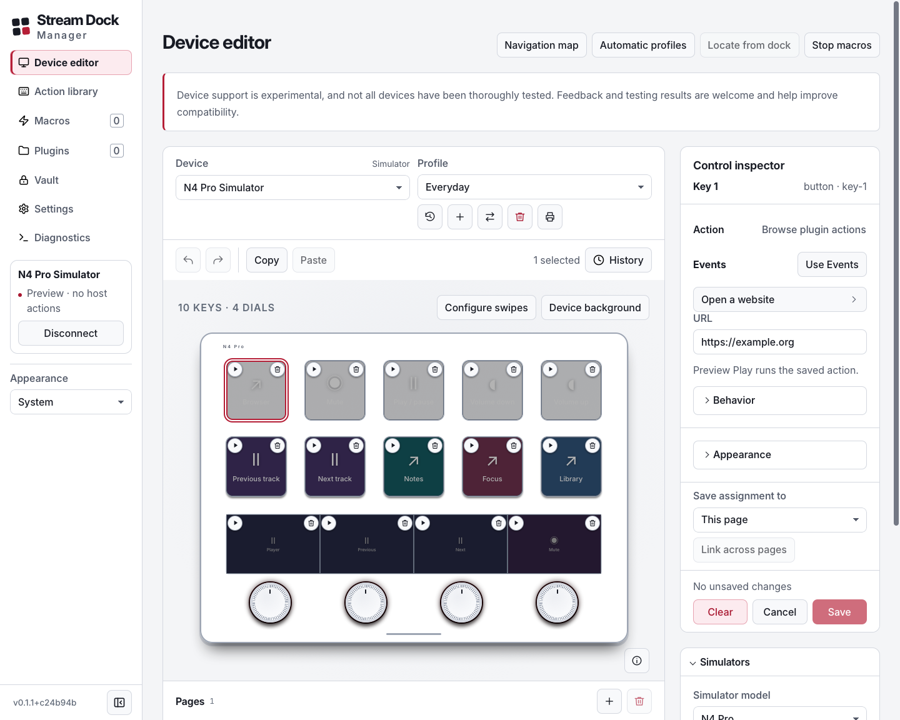
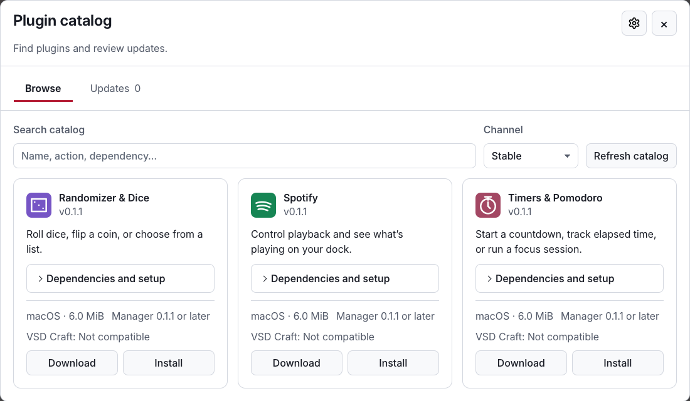
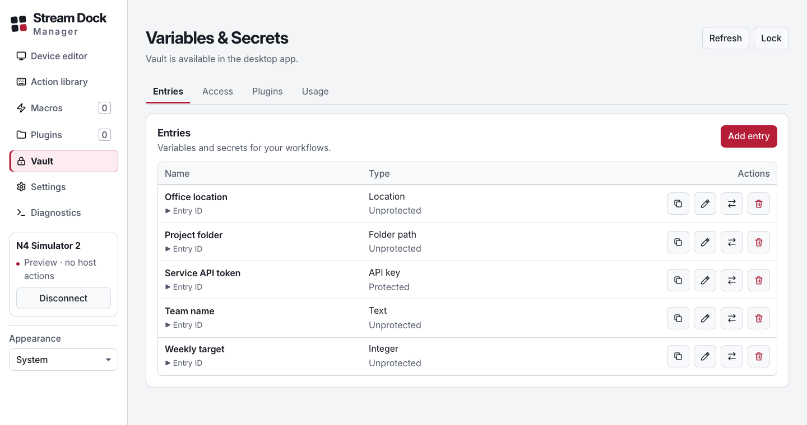

# Stream Dock Manager

Make your Stream Dock work the way you do. Assign actions to keys, dials, and touch
screens, organize controls into profiles and pages, and customize what appears on each LCD.

**[Download Manager][releases]** · [Try the browser demo][demo] · [Browse plugins][plugins]

<picture>
    <source media="(prefers-color-scheme: dark)" srcset="screenshots/dashboard-dark.png">
    <source media="(prefers-color-scheme: light)" srcset="screenshots/dashboard-light.png">
    
</picture>

## What you can do

| Feature                | What it does                                                                                   |
| ---------------------- | ---------------------------------------------------------------------------------------------- |
| **Device editor**      | Assign built-in actions, macros, or plugins. Preview layouts, labels, and media before saving. |
| **Profiles and pages** | Keep different layouts for different tasks and switch between them without rebinding controls. |
| **Plugin catalog**     | Discover and install plugins, and review the permissions they request.                         |
| **Vault**              | Manage reusable variables and credentials, and control which plugins can access them.          |

<table>
    <thead>
        <tr><th scope="col">Plugin catalog</th><th scope="col">Vault</th></tr>
    </thead>
    <tbody>
        <tr>
            <td width="50%" valign="top">
                <picture>
                    <source media="(prefers-color-scheme: dark)" srcset="screenshots/plugin-catalog-dark.png">
                    <source media="(prefers-color-scheme: light)" srcset="screenshots/plugin-catalog-light.png">
                    
                </picture>
            </td>
            <td width="50%" valign="top">
                <picture>
                    <source media="(prefers-color-scheme: dark)" srcset="screenshots/vault-dark.png">
                    <source media="(prefers-color-scheme: light)" srcset="screenshots/vault-light.png">
                    
                </picture>
            </td>
        </tr>
    </tbody>
</table>

_Screenshots use a simulator and sample data._

## Install

Choose a desktop installer from [GitHub Releases][releases], then follow the guide for your system.

| Platform                                       | Package   | Install guide                                                             |
| ---------------------------------------------- | --------- | ------------------------------------------------------------------------- |
| macOS 14+ · Apple Silicon                      | DMG       | [macOS](packaging/install-instructions/macos/INSTALL-INSTRUCTIONS.md)     |
| Windows 11 · x64                               | EXE       | [Windows](packaging/install-instructions/windows/INSTALL-INSTRUCTIONS.md) |
| Linux · x64 · Ubuntu 24.04 / Nobara 44 targets | DEB / RPM | [Linux](packaging/install-instructions/linux/INSTALL-INSTRUCTIONS.md)     |

Hardware support is experimental. [Check your exact model](hardware/README.md), read the
release notes for tested configurations, and back up your data before changing versions.

Packages are not publisher-signed. macOS bundles are ad hoc signed and not notarized.
Verify the source and checksums before opening them; follow the platform guide without
disabling system protections. The CLI is optional and separate. For Intel Mac source builds,
see [Packaging](packaging/README.md).

## Set up your first control

1. Quit any other dock manager, connect your dock, and open Manager.
2. Complete setup. On macOS, grant Input Monitoring and Accessibility to the copy you
   actually run, then choose **Check again → Connect devices**.
3. In **Device editor**, choose your dock or a simulator, then select a profile, page, and control.
4. Pick an action. If you customize the display, choose **Apply appearance**.
5. Choose **Save** in the control inspector.

Closing the editor keeps your controls running. To stop Manager, choose **Quit** from
its tray or menu-bar menu.

## Hardware-tested devices

| Model           | Exact device notes                               |
| --------------- | ------------------------------------------------ |
| N4 Pro          | [Variants and limits](hardware/n4-pro/README.md) |
| N1, VSD variant | [Device notes](hardware/n1-vsd/README.md)        |
| N3, VSD variant | [Device notes](hardware/n3-vsd/README.md)        |
| K1 Pro          | [Device notes](hardware/k1-pro/README.md)        |

Physical testing does not cover every feature, firmware version or operating system.
Similarly named variants do not inherit those results. [Other registered models](hardware/README.md)
remain experimental.

## Add plugins and Node.js

Open **Plugins**, choose a catalog package or **Import plugin**, review it, install it, and
explicitly enable it. Configure its settings before assigning an action.

JavaScript plugins need a supported **Node.js LTS** runtime in **Settings → Runtimes**.
This is separate from the Node version used to build Manager; installers do not bundle a plugin runtime.
Native plugins need a package for your OS and CPU. Protected Marketplace packages are not supported.

Canceling installation review keeps the downloaded package in the cache. Retrying the install
or reinstalling a removed plugin reuses that package if its SHA-256 and size match the catalog.
If the plugin is still installed and you want the same or an older version, turn on
**Force reinstall** in **Review installation**. Package checks and permission review still apply.

See the [plugin guide](REFERENCE.md#add-plugins-and-nodejs) for sleep behavior, import formats,
compatibility and runtime management.

## Keyboard recordings

Record and review a macro before using it. Permissions, target ownership and platform limits
still apply; not every Linux desktop provides the required capabilities. See the
[keyboard guide](REFERENCE.md#keyboard-recordings) before capture or playback.

## Troubleshooting

| Problem                        | Start here                                                                                                            |
| ------------------------------ | --------------------------------------------------------------------------------------------------------------------- |
| Device missing or cannot open  | Quit competing managers; check the selected device and [platform permissions](#install)                               |
| macOS says “not permitted”     | [HID access checklist](packaging/install-instructions/macos/INSTALL-INSTRUCTIONS.md#hid-device-reports-not-permitted) |
| Plugin will not start          | Open its **Health and compatibility** view; check its runtime and OS/CPU package                                      |
| Need to undo profile changes   | [Profile versions](REFERENCE.md#profile-versions-and-plugin-recovery)                                                 |
| Saved data will not load       | [Configuration recovery](REFERENCE.md#configuration-recovery); preserve the original data                             |
| Need help diagnosing a problem | Review **Diagnostics → Export diagnostic report** before sharing it                                                   |

Back up the application data folder while Manager and CLI are stopped. Find it through
**Settings → Open application data folder**. Profile exports are not a complete backup.

## Run from source

### Requirements

Installed packages do **not** need this build toolchain.

| Tool          | Required version                                                     |
| ------------- | -------------------------------------------------------------------- |
| Node.js / npm | Node 26.x / npm 12.2.3                                               |
| Rust / Cargo  | Rust 1.95+                                                           |
| Other tools   | Git, Python 3.11+; GNU Make for `make` commands                      |
| macOS         | Xcode Command Line Tools                                             |
| Windows       | MSVC C++ Build Tools and Windows SDK                                 |
| Linux         | [Native libraries and setup](CONTRIBUTING.md#linux-system-libraries) |

### Start the desktop app

```sh
git clone https://github.com/StreamDockManager/Manager.git StreamDockManager
cd StreamDockManager
npm ci
npm run desktop
```

The first native build can take a while. `make deps` followed by `make desktop` is the
Make-based alternative and uses the public settings in `workspace.toml`.

For development, keep test data separate from your normal configuration. Fully quit any
running Manager, then use a new absolute directory outside build/artifact folders:

```sh
npm run desktop -- -- -- --config /absolute/path/to/test-config
```

On macOS, the optional [signed development workflow](CONTRIBUTING.md#optional-local-macos-development-signing)
uses a stable local app identity. It is not release signing or a permission grant.

### Browser-only preview

```sh
npm run dev
```

Open the address printed by Vite. The browser preview uses temporary simulated data: no USB
access, native actions or real plugin execution. The [hosted demo](https://streamdockmanager.app/preview)
has the same basic limitations and resets on reload.

### CLI only

```sh
python3 scripts/prepare_patched_deps.py
cargo build --locked --release -p stream-dock-manager-cli
cargo run --locked --release -p stream-dock-manager-cli -- --help
```

Quit the desktop app before opening the same configuration from the CLI, or supply a separate
`--config /absolute/path` before the subcommand.

## Independence and license

Stream Dock Manager is independent and is not affiliated with, endorsed by, or sponsored by
**VSDInside, MiraBox, OpenDeck, or Elgato Stream Deck**. Product names identify compatibility,
not an official relationship.

[GPL-3.0-or-later](LICENSE) · [Third-party notices](THIRD_PARTY_NOTICES.md) ·
[Contributing](CONTRIBUTING.md) · [Packaging](packaging/README.md)

## Local cleanup

Stop builds and development apps first. Use `CLEAN_DRY_RUN=1 make clean` to see what
would be removed, then `make clean` to remove those generated build and cache files.
This keeps source, dependencies, installed app data, credentials, global caches, and
`.cache/signed-dev-data`. Pass custom `DATA_DIR` or `MANAGER_DATA_DIR` again if it
overlaps a generated directory. Copy any reports you need out of `artifacts/` first.

[releases]: https://github.com/StreamDockManager/Manager/releases/latest
[demo]: https://streamdockmanager.app/preview
[plugins]: https://streamdockmanager.app/plugins
